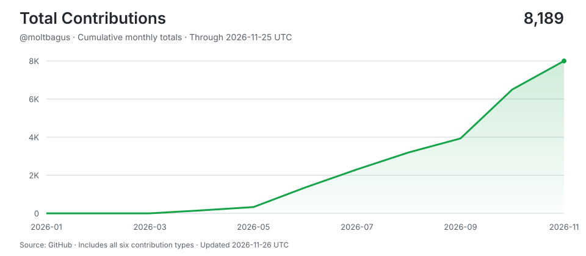

# moltbagus

> Shipping with AI agents around the clock -- human hours for thinking, machine hours for doing.
>
> Stats auto-updated by [aidevops](https://aidevops.sh).

<!-- STATS-START -->
## Work with AI

| Metric | Yesterday | Prior 7 Days | Prior 28 Days | Prior 365 Days |
| --- | ---: | ---: | ---: | ---: |
| Screen time (Mac) | 9.8h | 53.5h | 193.5h | /Users/colbert12716h* |
| Input activity (Mac) | 5.9h | 35.8h | 83.5h | /Users/colbert11954h* |
| Interactive human attention | 0.0h | 0.0h | 0.3h | 0.3h |
| Interactive AI generation | 0.0h | 0.0h | 0.4h | 0.4h |
| Worker-classified human attention | 0.0h | 0.0h | 0.0h | 0.0h |
| Worker/headless AI generation | 0.1h | 1.4h | 17.0h | 17.0h |
| Additive observed work | 0.1h | 1.4h | 17.7h | 17.7h |
| Interactive sessions | 0 | 0 | 37 | 37 |
| Worker sessions | 4 | 9 | 66 | 66 |

_Screen time from screen-time-history:daily-observations; collection status: ok. *365-day estimate uses observed calendar coverage._

_Input activity from macos-input-activity:idle-cutoff-300s (time from each keyboard, mouse or trackpad input until 5 idle minutes); collection status: ok. Input sampling began 2026-11-12 (15.6 of 28 days sampled); earlier days are not counted. *365-day estimate uses sampled calendar coverage._

_Periods are completed local calendar days ending at midnight; today is excluded._

_Human attention is unioned wall-clock time, so overlapping sessions are not double-counted. AI generation is additive machine work across sessions; it is not wall-clock concurrency._

_AI session 365-day totals cover 27 days of local assistant session history (not extrapolated)._

## AI Model Usage (last 30 days)

| Model | Requests | Input | Output | Cache read | Cache write | Cache Hit-Rate % | Session Count | Session Hours |
| --- | ---: | ---: | ---: | ---: | ---: | ---: | ---: | ---: |
| beam-free | 2,023 | 34.3M | 286K | 433.7M | 0 | 92.7% | 15 | 5.1h |
| iceman-free | 1,319 | 38.8M | 517K | 164.2M | 0 | 80.9% | 18 | 11.0h |
| glm-5.3-flash-free | 1,094 | 12.8M | 386K | 119.6M | 0 | 90.3% | 11 | 7.4h |
| hy | 586 | 20.6M | 35K | 52.2M | 0 | 71.6% | 1 | 2.0h |
| minimax-m3.1-flash-free | 454 | 7.5M | 126K | 58.5M | 0 | 88.6% | 8 | 3.1h |
| deepseek-v4.1-flash | 430 | 4.3M | 111K | 111.1M | 0 | 96.2% | 1 | 4.5h |
| recursive/flint-v1.0:free | 418 | 5.0M | 50K | 48.8M | 0 | 90.6% | 4 | 4.1h |
| tidepool-alpha-free | 266 | 8.7M | 57K | 73.7M | 0 | 89.4% | 1 | 2.6h |
| longcat-2.5-free | 164 | 549K | 25K | 20.1M | 0 | 97.3% | 2 | 0.7h |
| deepseek-v4.1-flash-free | 146 | 1.8M | 47K | 17.0M | 0 | 90.1% | 2 | 1.3h |
| nemotron-3.5-super-vl-free | 74 | 1.1M | 18K | 16.1M | 0 | 93.3% | 1 | 0.2h |
| hungerg-free | 72 | 1.3M | 31K | 4.5M | 0 | 77.3% | 2 | 0.4h |
| gpt-6.1-sol | 66 | 198 | 13K | 5.1M | 672K | 88.5% | 8 | 0.2h |
| nemotron-3.5-lightning-free | 42 | 327K | 3K | 4.1M | 0 | 92.7% | 1 | 0.1h |
| hy4-flash-free | 36 | 152K | 3K | 2.4M | 0 | 94.2% | 1 | 0.0h |
| claude-haiku-5-5 | 12 | 48 | 244 | 503K | 504K | 49.9% | 4 | 0.0h |
| liquid/lfm-2.5-2.6b:free | 7 | 17K | 1K | 344K | 0 | 95.1% | 1 | 0.0h |
| **Total** | **7,209** | **137.8M** | **1.7M** | **1,132.6M** | **1.1M** | **89.1%** | **66** | **42.7h** |

_1,273.4M total tokens processed. 89.1% cache hit rate._

## AI Model Usage (all time)

| Model | Requests | Input | Output | Cache read | Cache write | Cache Hit-Rate % | Session Count | Session Hours |
| --- | ---: | ---: | ---: | ---: | ---: | ---: | ---: | ---: |
| beam-free | 2,023 | 34.3M | 286K | 433.7M | 0 | 92.7% | 15 | 5.1h |
| iceman-free | 1,319 | 38.8M | 517K | 164.2M | 0 | 80.9% | 18 | 11.0h |
| glm-5.3-flash-free | 1,094 | 12.8M | 386K | 119.6M | 0 | 90.3% | 11 | 7.4h |
| hy | 586 | 20.6M | 35K | 52.2M | 0 | 71.6% | 1 | 2.0h |
| minimax-m3.1-flash-free | 454 | 7.5M | 126K | 58.5M | 0 | 88.6% | 8 | 3.1h |
| deepseek-v4.1-flash | 430 | 4.3M | 111K | 111.1M | 0 | 96.2% | 1 | 4.5h |
| recursive/flint-v1.0:free | 418 | 5.0M | 50K | 48.8M | 0 | 90.6% | 4 | 4.1h |
| tidepool-alpha-free | 266 | 8.7M | 57K | 73.7M | 0 | 89.4% | 1 | 2.6h |
| longcat-2.5-free | 164 | 549K | 25K | 20.1M | 0 | 97.3% | 2 | 0.7h |
| deepseek-v4.1-flash-free | 146 | 1.8M | 47K | 17.0M | 0 | 90.1% | 2 | 1.3h |
| nemotron-3.5-super-vl-free | 74 | 1.1M | 18K | 16.1M | 0 | 93.3% | 1 | 0.2h |
| hungerg-free | 72 | 1.3M | 31K | 4.5M | 0 | 77.3% | 2 | 0.4h |
| gpt-6.1-sol | 66 | 198 | 13K | 5.1M | 672K | 88.5% | 8 | 0.2h |
| nemotron-3.5-lightning-free | 42 | 327K | 3K | 4.1M | 0 | 92.7% | 1 | 0.1h |
| hy4-flash-free | 36 | 152K | 3K | 2.4M | 0 | 94.2% | 1 | 0.0h |
| claude-haiku-5-5 | 12 | 48 | 244 | 503K | 504K | 49.9% | 4 | 0.0h |
| liquid/lfm-2.5-2.6b:free | 7 | 17K | 1K | 344K | 0 | 95.1% | 1 | 0.0h |
| **Total** | **7,209** | **137.8M** | **1.7M** | **1,132.6M** | **1.1M** | **89.1%** | **66** | **42.7h** |

_1,273.4M total tokens processed. 89.1% cache hit rate._
<!-- STATS-END -->

<!-- PROJECTS-START -->
## Projects

- **[chesstest](https://github.com/moltbagus/chesstest)** -- No description
- **[motivational-quotes-cli](https://github.com/moltbagus/motivational-quotes-cli)** -- No description
- **[self-fixing-loop-agent-pattern](https://github.com/moltbagus/self-fixing-loop-agent-pattern)** -- No description
- **[shoteye](https://github.com/moltbagus/shoteye)** -- Native macOS screenshot and pixel-inspection tool
- **[solana-auditor-skill](https://github.com/moltbagus/solana-auditor-skill)** -- No description
<!-- PROJECTS-END -->

<!-- CONTRIBUTIONS-START -->
## Contributions

- **[aidevops](https://github.com/marcusquinn/aidevops)** -- Vibe-Coding is easy. DevOps is hard. OpenCode & Git token-efficient AI agent automation for your app, business, and personal development. Opinionated tools, services, CLI & API stack for speed, security, and 24/7 results. Open-source first. SOTA everything. The best AI harness for GitHub & teamwork.
- **[FastVideo](https://github.com/hao-ai-lab/FastVideo)** -- A unified inference and post-training framework for accelerated video generation.
- **[ruflo](https://github.com/ruvnet/ruflo)** -- 🌊 The leading agent meta-harness. Deploy intelligent multi-player swarms, coordinate autonomous workflows, and build conversational AI systems. Features adaptive memory, self-learning intelligence, RAG integration, and native Claude Code / Codex / Hermes and many more Integrated
<!-- CONTRIBUTIONS-END -->

## Connect

---

<!-- UPDATED-START -->
_Stats auto-updated 2026-11-28 08:54 UTC by [aidevops](https://aidevops.sh) pulse._
<!-- UPDATED-END -->

<!-- TOTAL-CONTRIBUTIONS-START -->

  <a href="https://commit-history.com/moltbagus?metric=total" target="_blank" rel="noopener noreferrer">
    <picture>
      <source media="(prefers-color-scheme: dark)" srcset="assets/contributions/total-dark.svg" />
      
    </picture>
  </a>

[Verify on commit-history.com](https://commit-history.com/moltbagus?metric=total) · [Chart data](assets/contributions/total.json)

Includes commits, issues, pull requests, reviews, repositories, and restricted contributions. Refreshed daily through the prior UTC day; commit-history.com may use a different refresh cutoff. GitHub controls link navigation—Ctrl/Cmd-click opens verification in a new tab.
<!-- TOTAL-CONTRIBUTIONS-END -->
