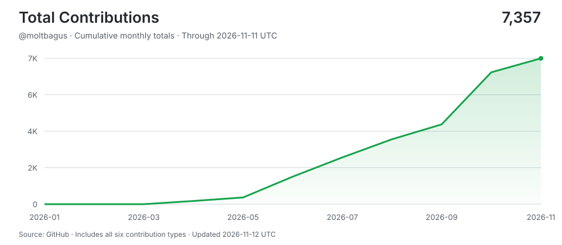

# moltbagus

> Shipping with AI agents around the clock -- human hours for thinking, machine hours for doing.
>
> Stats auto-updated by [aidevops](https://aidevops.sh).

<!-- STATS-START -->
## Work with AI

| Metric | Yesterday | Prior 7 Days | Prior 28 Days | Prior 365 Days |
| --- | ---: | ---: | ---: | ---: |
| Input activity (Linux) | 0.3h | 2.6h | 2.6h | unavailable |
| Interactive human attention | 0.0h | 0.0h | 0.0h | 0.0h |
| Interactive AI generation | 0.0h | 0.0h | 0.0h | 0.0h |
| Worker-classified human attention | 0.0h | 0.0h | 0.0h | 0.0h |
| Worker/headless AI generation | 0.0h | 0.0h | 0.0h | 0.0h |
| Additive observed work | 0.0h | 0.0h | 0.0h | 0.0h |
| Interactive sessions | 0 | 0 | 0 | 0 |
| Worker sessions | 0 | 0 | 0 | 0 |

_Input activity from linux-input-activity:idle-cutoff-300s; collection status: ok, unavailable (fewer-than-7-sampled-days). Input sampling began 2026-11-10 (5.0 of 28 days sampled); earlier days are not counted. Latest sample measured: terminal input only; no desktop session on this host._

_Periods are completed local calendar days ending at midnight; today is excluded._

_Human attention is unioned wall-clock time, so overlapping sessions are not double-counted. AI generation is additive machine work across sessions; it is not wall-clock concurrency._
<!-- STATS-END -->

<!-- PROJECTS-START -->
## Projects

- **[ccaf2026](https://github.com/moltbagus/ccaf2026)** -- No description
- **[chesstest](https://github.com/moltbagus/chesstest)** -- No description
- **[motivational-quotes-cli](https://github.com/moltbagus/motivational-quotes-cli)** -- No description
- **[self-fixing-loop-agent-pattern](https://github.com/moltbagus/self-fixing-loop-agent-pattern)** -- No description
- **[shoteye](https://github.com/moltbagus/shoteye)** -- Native macOS screenshot and pixel-inspection tool
- **[solana-auditor-skill](https://github.com/moltbagus/solana-auditor-skill)** -- No description
<!-- PROJECTS-END -->

<!-- CONTRIBUTIONS-START -->
## Contributions

- **[aidevops](https://github.com/marcusquinn/aidevops)** -- Vibe-Coding is easy. DevOps is hard. OpenCode & Git token-efficient AI agent automation for your app, business, and personal development. Opinionated tools, services, CLI & API stack for speed, security, and 24/7 results. Open-source first. SOTA everything. The best AI harness for GitHub & teamwork.
- **[FastVideo](https://github.com/hao-ai-lab/FastVideo)** -- A unified inference and post-training framework for accelerated video generation.
- **[ruflo](https://github.com/ruvnet/ruflo)** -- 🌊 The leading agent meta-harness. Deploy intelligent multi-player swarms, coordinate autonomous workflows, and build conversational AI systems. Features adaptive memory, self-learning intelligence, RAG integration, and native Claude Code / Codex / Hermes and many more Integrated
<!-- CONTRIBUTIONS-END -->

## Connect

---

<!-- UPDATED-START -->
_Stats auto-updated 2026-11-14 16:18 UTC by [aidevops](https://aidevops.sh) pulse._
<!-- UPDATED-END -->

<!-- TOTAL-CONTRIBUTIONS-START -->

  <a href="https://commit-history.com/moltbagus?metric=total" target="_blank" rel="noopener noreferrer">
    <picture>
      <source media="(prefers-color-scheme: dark)" srcset="assets/contributions/total-dark.svg" />
      
    </picture>
  </a>

[Verify on commit-history.com](https://commit-history.com/moltbagus?metric=total) · [Chart data](assets/contributions/total.json)

Includes commits, issues, pull requests, reviews, repositories, and restricted contributions. Refreshed daily through the prior UTC day; commit-history.com may use a different refresh cutoff. GitHub controls link navigation—Ctrl/Cmd-click opens verification in a new tab.
<!-- TOTAL-CONTRIBUTIONS-END -->
