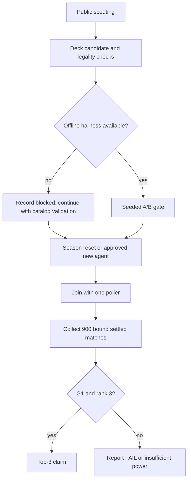

# Match S7 Top-3 TCG Bots - Plan

## Goal Capsule

**Objective:** The bot reaches and holds top-3 class arena performance: at least 47% win rate over 900 bound settled matches and rank 3 or better at sample close, with every claim bound to the commit and process that produced it.

**Means:** Rebuild around a proven archetype at season reset, restore the pre-regression policy baseline, and gate every live claim with bound measurement (KTD1, KTD4).

**Product authority:** The arena leaderboard is the authority for rank. `wr_report.py` over settled matches is the authority for win rate. Neither substitutes for the other.

**Stop conditions:** Stop when the objective is met and independently checked, or when a blocker changes scope. Record blocked states for the season deck lock and the unavailable offline harness.

**Execution profile:** Code. The execution owner takes the units in dependency order and tracks progress outside this plan.

**Open blockers:** The season deck is locked in remote mode. The offline A/B harness cannot load the season card pool. The next season's availability was not verified; its status is an assumption.

---

## Product Contract

### Summary

Enrich the existing world-class plan into an executable path to top-3 performance. The work combines a truthful baseline, a proven deck rebuild, policy restoration, and gates derived from the live board.

**Product Contract preservation:** changed R6 to the top-3 benchmark; R1–R5, R7, R10–R11 preserved; R8 and R9 stay deferred and blocked respectively; R12–R13 added.

### Problem Frame

The bot is at 22.33% over 945 season matches (211W, 734L), rank 29. The recent 635 matches after the final policy build sit at 15.43%, a statistically significant decline from the earlier 36.02% window. The earlier 36% was a 261-match sample and is superseded by the larger sample.

The top three agents run 47.24% to 59.24% with proven archetypes and dense trainer spines. Two run Dreepy, Drakloak, Dragapult ex, Budew, Munkidori, Chi-Yu, Fezandipiti ex, Meowth ex, and dual Psychic/Fire energy. One runs Teal Mask Ogerpon ex, Hydrapple ex, the Chikorita line, Dipplin, Applin, Tapu Bulu, and Forest of Vitality. Their trainers include Poke Pad, Buddy-Buddy Poffin, Ultra Ball, Lillie's Determination, Boss's Orders, Night Stretcher, Judge, and Crushing Hammer.

Our list has 12 Basic Pokemon, no unconditional draw supporter, no Crushing Hammer, and three near-dead Crispin slots. The policy changes shipped in the last cycle coincide with a large regression. Deck construction is the ceiling; scoring tweaks alone cannot close a 25-point gap.

### Requirements

**Policy correctness**

R1. Before an attack, the policy resolves legal evolution and ability actions. It plays a card when the bench is empty or the best attack does zero printed damage; otherwise it attacks. It does not blindly play every legal Trainer.

R2. When the bench is empty and a Basic can be played to it, the policy plays that Basic before attacking.

R3. A legal evolution is chosen before an attack. When multiple evolutions are legal, the target with the higher board value wins, independent of the server's option order.

R4. Attack scoring uses effect-scaled damage for the deck's attacks. Weakness, resistance, and prize value remain deferred.

R12. The policy does not regress against the pre-change baseline on the replay corpus; any regression must be characterized and reverted before deck work proceeds.

**Measurement integrity**

R5. `wr_report.py --json` embeds the commit, process id, process start time, and competition id, so the evidence file itself proves the measurement's binding.

R5a. A measurement whose process predates the measured commit is invalid and is not quoted as a result.

R6. Win-rate gates have real slack at their stated sample: G1 is at least 47% at n at least 900 with a Wilson lower bound at least 43.5%; G2 is at least 55% at n at least 1200 with a lower bound at least 52.0%; G3 is at least 59% at n at least 1500 with a lower bound at least 56.0% and rank 1 at sample close.

R7. Rank and win rate are separate signals. The plan never equates a win-rate threshold with a leaderboard position.

R13. A top-3 claim requires rank 3 or better at sample close together with G1; a leader claim requires G3.

**Evidence integrity**

R10. Competition id, agent id, season number, and deck thesis have one source of truth. No prior-season string appears in current evidence, labels, or state.

R11. The requirements plan is committed under `docs/plans/` in `ce-unified-plan/v1` shape. A working-copy-only spec is not the plan of record.

### Key Decisions

- **Rebuild the deck around a proven archetype.** The top three run established engines; scoring cannot repair a 12-Basic, draw-poor list. Governs R12, R6.
- **Restore the pre-regression policy before adding new behavior.** The recent large sample shows a real decline. Governs R12.
- **Pre-register gates with slack.** A gate whose bound sits on the point estimate is not a bound. Governs R6–R7, R13.
- **Rank is a rating, not a win rate.** Governs R7, R13.
- **No top-3 claim without an independent gate.** The claim requires a committed plan, a bound measurement, and a gate pass. Governs R5–R7, R11.

<!-- ce-section: work-relationships -->
### How This Work Fits Together

This plan now owns the full path: baseline restoration, deck rebuild, policy adaptation, measurement, and live rollout.

- **Current slice:** R1–R7, R10–R13.
- **Deferred to the next season:** deck deployment and live join with the new list. The current season deck is locked.
- **Blocked:** offline A/B cannot gate the deck until the engine supports the season card pool.
- **Still to decide:** weakness and resistance modeling, and prize-value weighting beyond the KO bonus.

### Key Flows

F1. **Decision flow.**
- **Trigger:** a pending action arrives.
- **Steps:** enumerate legal options; resolve attach; resolve evolution and ability; play a card only when the bench is empty or the attack does zero damage; otherwise score and attack; submit.
- **Covers R1–R4.**

F2. **Measurement flow.**
- **Trigger:** a policy or deck change is ready to ship.
- **Steps:** commit; restart only when active matches are zero; record process binding; collect the bound sample; run the win-rate report; evaluate G1–G3 and R13.
- **Covers R5–R7, R13.**

F3. **Season transition flow.**
- **Trigger:** the next season opens or a new agent is approved.
- **Steps:** validate the deck against the catalog; join with the new list; start one poller; collect the bound sample; evaluate gates.
- **Covers R10, R12, R13.**

### Acceptance Examples

AE1. **Empty bench, damaging attack legal.**
- **Covers R2.**
- Given an empty bench, a playable Basic, and a 20-damage attack, the chosen action is the play.

AE2. **Evolution, damaging attack legal.**
- **Covers R1, R3.**
- Given a legal evolution and a 40-damage attack, the chosen action is the evolution. The attack stays legal afterward.

AE3. **No development action.**
- **Covers R1, R4.**
- Given only an attack and an end-turn option, the attack is chosen.

AE4. **Non-empty bench, damaging attack legal.**
- **Covers R1.**
- Given a non-empty bench and a 20-damage attack, the chosen action is the attack, not a blind Trainer play.

AE5. **Replay regression.**
- **Covers R12.**
- Given the recorded pre-regression decision corpus, the restored policy matches the baseline choices on the named fixtures.

### Success Criteria

- G1: at least 47% over n at least 900 bound settled matches, Wilson lower bound at least 43.5%.
- G2: at least 55% over n at least 1200, lower bound at least 52.0%.
- G3: at least 59% over n at least 1500, lower bound at least 56.0%, rank 1 at sample close.
- Top-3 claim: G1 and rank 3 or better at sample close.
- `no_active_pokemon` share of losses falls to at most 15%.

### Scope Boundaries

- Not building a full PTCGL engine, a transformer policy, or a self-play training loop in this plan.
- **Deferred to the next season:** deck deployment and live join. The current season deck is locked.
- **Blocked:** offline A/B cannot gate the deck change until the engine supports the season card pool.
- Not claiming a win-rate improvement from a sub-100 window or a leaderboard delta.
- New agents, paid entries, and hosted deploys remain owner-approved actions.

### Dependencies / Assumptions

- The arena exposes settled match records and the card and attack catalogs used by the report.
- The live service runs the hardened async entrypoint.
- The current season deck is locked; deck changes ship only after a season reset or owner-approved new agent.
- A committed 500-match baseline window in `docs/precommit/2026-11-21-c-baseline-500.md` forbids policy or deck changes inside its window. U6 must confirm it has closed or been formally superseded before deployment.
- The next season's availability is unverified. The scoping query timed out; the plan treats it as an assumption, not evidence.

### Outstanding Questions

- **Deferred to Planning:** Which archetype ships first, Dragapult ex or the test-validated Alakazam/Audino candidate in `deck_candidate.json`? The plan defaults to Dragapult ex because two of the top three use it.
- **Deferred to Planning:** Which cards leave the deck to reach 15 Basics, and which draw supporters replace them?
- **Deferred to Planning:** Whether to extend the offline harness or keep it blocked for this cycle.
- **Deferred to Planning:** Weakness/resistance modeling and prize-value weighting.

### Sources / Research

- `docs/specs/2026-11-20-world-class-tcg-bot.md` — diagnostic spec and option-type table.
- `docs/brainstorms/2026-11-18-tcg-gap-analysis.md` — deck-ratio and search-lever evidence.
- Public S7 leaderboard and agent stats for the three named agents.
- Five recent public matches per top agent with decisions joined to the card and attack catalogs.
- Obsidian note `Hermes/TCG-Bot-Top3-Scout-2026-11-23.md`.
- 945 season match records and the post-build 635-match window.
- `scoring.py`, `wr_report.py`, `belief.py`, `ismcts.py` — current decision and measurement code.

---

## Planning Contract

### Key Technical Decisions

KTD1. **Rebuild the deck before adding more scoring heuristics.** The 25-point gap to the top three is deck-shaped; the current list lacks draw, energy denial, and enough Basics. Governs R12, R6.

KTD2. **Start from the pre-regression policy and add only characterized changes.** The last policy cycle coincided with a drop from 36.02% to 15.43% over a large sample. Governs R12.

KTD3. **Use a single season-config authority.** The existing shared config stays the source for competition id, agent id, season number, and deck thesis. Governs R10.

KTD4. **Bind every measurement to commit, process, and competition.** A rate without a binding is not evidence. Governs R5, R5a, R13.

KTD5. **Extend the existing scoring and test files instead of introducing a new policy framework.** The repo already has typed option scoring, regression fixtures, and a report tool. Governs R1–R4.

### High-Level Technical Design

### Assumptions

- The next season opens with the same agent and resets the deck lock. If it does not, the owner must approve a new agent; that is a scope change.
- Dragapult ex is the first deck candidate because two of the top three use it. The test-validated Alakazam/Audino candidate in `deck_candidate.json` is the fallback. Adopting Dragapult overrides the existing test that rejects Budew.
- Weakness and resistance remain deferred because the card type codes and attack energy codes are not yet proven to align.

### Implementation Constraints

- Restart only when active matches are zero.
- Run one poller under the existing instance lock.
- Keep repo paths portable and use the shared config authority.
- Preserve the existing acceptance fixtures and requirement IDs.

### Sequencing

U1 precedes U2 because a regressed baseline invalidates later comparisons. U2 precedes U3 because policy changes depend on the new deck's card ids. U4 is blocked and does not gate U2. U5 runs before U6 but after U1 so the gates measure a trustworthy baseline. U6 is the final live rollout.

---

## Implementation Units

### U1. Restore and characterize the pre-regression policy

- **Goal:** Establish a trustworthy baseline and remove the large regression before any new deck work.
- **Requirements:** R12, R1–R4.
- **Dependencies:** none.
- **Files:** `scoring.py`, `tests/test_regression_baseline.py`, `docs/plans/2026-11-20-1914-feat-world-class-tcg-bot-plan.md`.
- **Approach:** Replay the recorded public decision corpus against the current scorer and the pre-regression scorer. Identify the first commit where named fixtures change. Restore that behavior behind the existing tests. Keep the current effect-scaling and tie-break fixes only where they are supported by fixtures.
- **Execution note:** Start with characterization coverage from recorded decisions before changing behavior.
- **Test scenarios:**
  - Empty-bench fixture from the pre-regression corpus chooses the Basic play.
  - Non-empty-bench fixture with a damaging attack chooses the attack.
  - Evolution fixture chooses the same target as the baseline.
  - Effect-damage fixture matches the printed attack text.
  - Reversing option order does not change the chosen evolution target.
  - A named regression fixture that changed after the last policy cycle is restored to its baseline choice.
- **Verification:** Named fixtures pass and the full suite passes. The chosen baseline commit is recorded in the plan's evidence.

### U2. Build the top-3 deck candidate

- **Goal:** Produce a legal 60-card list with 15–16 Basics, a draw supporter, and energy denial.
- **Requirements:** R6, R12, R13.
- **Dependencies:** U1.
- **Files:** `arena_config.py`, `bot.py`, `bot_async.py`, `tests/test_deck_viability.py`, `references/competitive-deck-candidates.md`.
- **Approach:** Start from the public Dragapult ex list: Dreepy, Drakloak, Dragapult ex, Budew, Munkidori, Chi-Yu, Fezandipiti ex, Meowth ex, Psychic and Fire energy. Add Poke Pad, Buddy-Buddy Poffin, Ultra Ball, Lillie's Determination, Boss's Orders, Night Stretcher, Judge, and Crushing Hammer. The repository already holds a test-validated Alakazam/Audino candidate in `deck_candidate.json`; treat it as the fallback. Adopting Dragapult overrides the existing viability test that rejects Budew; record that override explicitly. Remove dead cards and Crispin. Validate against the catalog before any live join.
- **Test scenarios:**
  - Deck has exactly 60 cards and no card exceeds four copies, with energy exempt.
  - Deck has 15 or 16 Basic Pokemon.
  - Every evolution has its pre-evolution present.
  - Every attack id in the deck has a scoring entry.
  - No ACE SPEC card is present unless explicitly intended.
  - Crushing Hammer and Lillie's Determination are present.
  - Crispin is absent from a mono-energy or dual-energy list where it cannot fetch two types.
  - Catalog validation returns zero unknown card ids.
- **Verification:** Deck-viability tests pass and catalog validation reports zero errors.

### U3. Adapt policy to the new archetype

- **Goal:** Score the new deck's attacks, abilities, and trainer effects correctly.
- **Requirements:** R1–R4, R12.
- **Dependencies:** U1, U2.
- **Files:** `scoring.py`, `belief.py`, `tests/test_scoring_priority.py`, `tests/test_deck_viability.py`.
- **Approach:** Extend the damage table for the new attack ids, reset the belief prior to observed cards, add energy-denial preference for Crushing Hammer, and rank Supporter plays only when the play target can be identified. Where the hand is hidden, keep the existing conservative rule. If the fallback Alakazam/Audino candidate is adopted instead, replace the Dragapult, Budew, and Crushing Hammer fixtures with that list's attack and trainer ids.
- **Execution note:** Implement new archetype behavior test-first from public decision fixtures.
- **Test scenarios:**
  - Budew Itchy Pollen is preferred over a weak attack when Item lock is available.
  - Crushing Hammer is preferred over an attack when the opponent has two or more attached energy.
  - Lillie's Determination is used before a second attack when the hand is low and the option is identifiable.
  - Phantom Dive damage uses the printed effect, not the base column.
  - Dragapult ex evolution outranks a damaging attack.
  - Belief prior is empty at match start and updates only from observed cards.
  - Unknown attack ids score neutrally and never crash.
- **Verification:** New fixtures pass and the full suite passes.

### U4. Extend the offline A/B harness

- **Goal:** Make seeded offline comparison available for the new deck and policy.
- **Requirements:** R12, R13.
- **Dependencies:** U2.
- **Files:** `ab_harness/deck.py`, `ab_harness/tests/`, `ab_harness/ENGINE.lock`.
- **Approach:** Add the new card ids and attack ids to the engine adapter. Raise an explicit unresolved-card error when the engine lacks a card. If the engine cannot support the list, record the unit as blocked; do not present a proxy deck as evidence.
- **Execution note:** Engine parity is a gate; a proxy result is not arena evidence.
- **Test scenarios:**
  - Seeded engine game reproduces the same action sequence twice.
  - Deck conversion resolves every card id in the candidate list.
  - A known-better policy beats the baseline over the seeded cohort.
  - Missing engine cards produce an explicit unresolved-card error.
- **Verification:** Either the seeded A/B distinguishes a known-better policy, or the blocked state is recorded with the missing card ids.

### U5. Bind gates and telemetry to the report

- **Goal:** Make G1–G3 and rank checks reproducible from the evidence file.
- **Requirements:** R5, R5a, R6, R7, R13.
- **Dependencies:** U1.
- **Files:** `wr_report.py`, `tests/test_wr_report.py`.
- **Approach:** Keep the existing binding fields. Add explicit gate fields and a rank input. Distinguish FAIL from NOT_RUN for insufficient power. Use the Wilson formula with the sample sizes in R6. Add a commit-time lookup so a process older than the measured commit can be rejected.
- **Test scenarios:**
  - Report JSON contains commit, process id, process start, and competition id.
  - A 47% rate at n=900 produces lower bound 43.76% and PASS against floor 43.5%.
  - A 47% rate at n=300 produces NOT_RUN, not FAIL, for G1.
  - Rank 3 with 47% passes the top-3 claim; 47% with rank 12 does not.
  - A process older than the measured commit is rejected.
- **Verification:** Report tests pass and a sample report artifact carries the gate fields.

### U6. Season transition and live measurement

- **Goal:** Deploy the rebuilt list safely and measure it against the pre-registered gates.
- **Requirements:** R5a, R6, R7, R10, R12, R13.
- **Dependencies:** U1, U2, U3, U5. U4 is informational and may remain blocked.
- **Files:** `arena_config.py`, `restart_when_idle.sh`, `docs/plans/2026-11-20-1914-feat-world-class-tcg-bot-plan.md`.
- **Approach:** Confirm the committed 500-match baseline window has closed or been formally superseded. Wait for the season reset, join with the validated list, start one poller, and collect 900 bound settled matches. Record the restart timestamp and the report artifact. Stop on a blocker or a gate result.
- **Execution note:** Restart only when active matches are zero; a matched join must start polling immediately.
- **Test scenarios:**
  - Join returns matched or queued and the worker starts polling without a gap.
  - The 500-match baseline window is closed or formally superseded before the join.
  - A second poller is refused by the instance lock.
  - Restart occurs only when active matches are zero.
  - The report artifact binds to the process that played the measured matches.
  - G1 at n=900 and rank 3 produce a top-3 result; anything else produces FAIL or NOT_RUN.
- **Verification:** Live evidence shows one poller, a bound report, and a gate verdict.

---

## Verification Contract

- Run the full Python suite from the repository root. The expected state is all tests passing; skips must name their missing optional dependency.
- Run the win-rate report with an explicit commit binding and a JSON artifact path for every live claim.
- Check the live service state, process start time, and module mtime before quoting a rate.
- Wilson lower bound formula: `(p + z^2/(2n) - z*sqrt(p(1-p)/n + z^2/(4n^2))) / (1 + z^2/n)` with z = 1.959963984540054.
- Derived gate values: 47% at n=900 gives 43.76%, above the 43.5% floor; 55% at n=1200 gives 52.17%, above the 52.0% floor; 59% at n=1500 gives 56.49%, above the 56.0% floor.
- FAIL means the bound sample was collected and the gate was missed. NOT_RUN means the sample is short or the binding is invalid. Do not merge the two states.

---

## Definition of Done

- R1–R7 and R10–R13 each have a passing test or a bound live result.
- U1 restores a named replay baseline; U2 produces a catalog-valid deck; U3 passes archetype fixtures; U4 is either green or recorded blocked; U5 emits bound gate fields; U6 produces a gate verdict.
- The top-3 claim is supported by G1, rank 3 or better, and a bound report artifact.
- The leader claim is supported by G3 and rank 1.
- An independent check uses the public leaderboard and a freshly generated report; the implementation's own output is not sufficient.
- Abandoned experiments and proxy-deck results are removed from the active diff or explicitly marked blocked.

---

## Appendix

- The scoping question about the primary bar timed out. The recorded branch is top-3 entry as the primary gate, leader as stretch.
- The scoping question about deck path timed out. The recorded branch is to wait for the season reset with the same agent; a new agent needs owner approval.
- The offline harness is documented as blocked, not as a gate.
