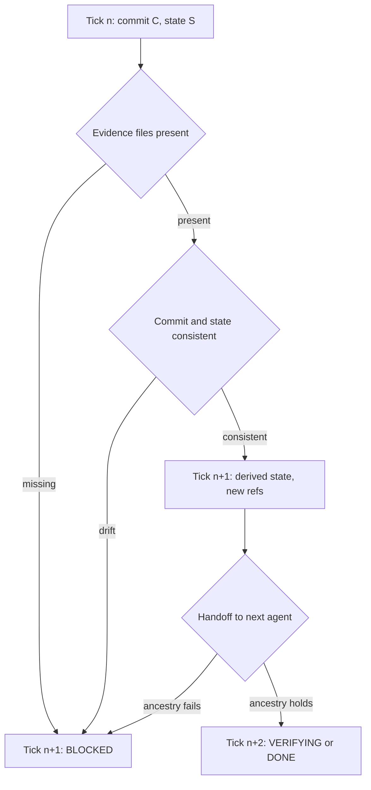
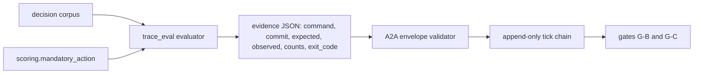

# TRACE Eval, A2A Handoff and Loop-Graph Contract - Plan

## Goal Capsule

**Objective:** An operator can hold one bounded, offline, reproducible evaluation loop for this TCG policy: each decision is a replayable trace, each failure has one named class, each loop tick points at immutable evidence, and a successor agent can verify the same claim without starting a bot or reading credentials.

**Means:** Extend the decision corpus already written by `telemetry.py` and the offline gate already implemented in `replay.py` with a trace schema, a closed failure taxonomy, a handoff envelope, and an append-only tick chain.

**Product authority:** `~/.arena-tcg-decisions.jsonl` is the decision corpus. `replay.py` is the offline choice-delta gate. `arena_config.py` holds identity constants. Win rate over settled matches belongs to `wr_report.py` and is outside this scope.

**Stop conditions:** This work ends at a committed implementation-ready artifact and offline evidence. No policy change, live run, or agent dispatch is part of this scope.

**Open blockers:** The belief ISMCTS mandatory-action fix is in live code but not yet guarded by a trace-level regression gate, and the corpus still contains the 412 of 599 eligible decisions it affected. Offline A/B over the season pool remains blocked by the card-pool gap recorded in the world-class plan. Paid Stakes authorization is absent.

---

## Product Contract

### Summary

Define an implementation-ready contract for TRACE evaluation, agent-to-agent handoff, and a loop tick/state graph. The contract makes offline claims checkable and gives an implementer a fixed WHAT and HOW.

### Problem Frame

The bot already writes one JSON line per decision with `matchId`, `seq`, `chosen`, `policyPath`, `policyVersion`, `latencyMs`, `obs`, and `state`. `replay.py` already separates illegal actions, unscorable records, choice deltas, and the code path that answered each decision.

What is missing is a contract around those signals. A decision-affecting change shipped inside a frozen 500-match window and voided that window without an automated signal. The belief ISMCTS path bypassed mandatory attach and development in 412 of 599 eligible decisions, and that was found by manual inspection rather than by a named failure class. A successor process has no machine-readable record of which evidence its predecessor trusted, so it can act on stale state.

The cost is repeated hand-derived claims and untraceable policy drift.

### Key Decisions

**Offline-only evaluation.** Every command in this contract runs without arena API calls or credentials. (session-settled: user-directed — chosen over live replay and bot start: the task grants no live changes.) Governs R8, R10.

**Implementation-ready artifact.** This file records WHAT must be true and HOW it is built. (session-settled: user-directed — chosen over requirements-only: the user asked to implement the evaluator.) Governs R17.

**Extend the existing corpus, do not add a second store.** TRACE fields are additive to records already written by `telemetry.py`, so old and new records stay in one replayable file. Governs R1, R4.

**Append-only loop state.** A tick references evidence and never rewrites an earlier tick; current state is derived, not asserted. Governs R14, R15.

**Paid Stakes is outside the product identity.** No requirement, gate, or eval command in this plan touches Stakes entry, wallet, or bankroll. (session-settled: user-directed — chosen over including Stakes: `GOVERNANCE.md` routes paid entry to ESCALATE.)

### Actors

A1. Offline eval runner — executes the R8 command set and writes R9 evidence.
A2. Diagnosing agent — classifies findings under R5 through R7 and emits an R11 envelope.
A3. Implementing agent — validates an envelope under R12 before changing code.
A4. Loop coordinator — appends R14 ticks and applies the R16 drift check.

### Requirements

**Trace schema**

R1. A decision record carries the existing field set `matchId`, `seq`, `chosen`, `policyPath`, `policyVersion`, `latencyMs`, `obs`, and `state`, plus `traceId` formed from `matchId` and `seq`, and `parentTraceId` when the decision follows an earlier action in the same match.

R2. A record taken from a turn with a mandatory attach or development action carries `mandatoryActionEligible: true` and `mandatoryActionSatisfied` set to the observed outcome, so the 412 of 599 bypass class is countable without re-deriving the board.

R3. A record older than `l0-2026-11-23-belief-ismcts`, or written before the eligibility field existed, carries `mandatoryActionEligible: null` and is reported as unknown rather than satisfied.

R4. A record never contains credentials, opponent hidden information, or a literal host home path; `obs` keeps the public-only pruning already implemented in `telemetry.py`.

**Failure taxonomy**

R5. Each finding has exactly one class from the closed set `ILLEGAL_ACTION`, `MANDATORY_ACTION_BYPASS`, `ATTRIBUTION_MISMATCH`, `UNSCORABLE_RECORD`, `POLICY_DELTA`, `LATENCY_REGRESSION`, `SCHEMA_INVALID`.

| Class | Existing signal | New condition |
|---|---|---|
| `ILLEGAL_ACTION` | `replay.py` `illegal` count | chosen action absent from its own legal list |
| `MANDATORY_ACTION_BYPASS` | `mandatoryActionEligible` from R2 | eligible turn with `mandatoryActionSatisfied: false` |
| `ATTRIBUTION_MISMATCH` | `replay.py` `policyVersions` | record version differs from the active precommit boundary |
| `UNSCORABLE_RECORD` | `replay.py` `unscorable` count | record cannot be scored by current policy |
| `POLICY_DELTA` | `replay.py` `changed` count | current choice differs from recorded choice |
| `LATENCY_REGRESSION` | `latencyMs` | exceeds the bound set in the enriched plan, not asserted here |
| `SCHEMA_INVALID` | evidence and tick references | required field, reference, or ancestry missing |

R6. Each finding carries `traceId`, its R5 class, severity of `blocking` or `observed`, and the ID of the requirement it violates; a class with no owning requirement is reported as `SCHEMA_INVALID` rather than added to the taxonomy.

R7. `POLICY_DELTA` alone never fails a gate; it becomes `blocking` only when paired with another R5 class or when no accepted-change note is attached under R13.

**Automated eval commands**

R8. The eval entry points are limited to `python3 -m pytest -q`, the compile check in `.agent-team/config.json`, and `python3 replay.py --path <corpus> --json-out <evidence>`, where `<corpus>` is `~/.arena-tcg-decisions.jsonl` or a repo-relative copy and `<evidence>` is repo-relative under `evidence/`.

R9. Each R8 command writes one JSON evidence file under `evidence/` containing `command`, `commit`, `expected`, `observed`, per-class counts from R5, and `exit_code`; an evidence file missing any of these fields fails the eval.

R10. A command that cannot run offline is reported `NOT_RUN` with its missing prerequisite named. Credentialed fetch and bot start are not R8 commands.

**Agent-to-agent handoff contract**

R11. A handoff is one JSON envelope with `task_id`, `from_agent`, `to_agent`, `base_commit`, `artifact_path`, `requirement_ids`, `findings`, `checks`, `blockers`, and `next_action`, committed as evidence rather than passed only in chat.

R12. The receiving agent validates before acting: it re-runs the R8 commands cited in `checks` and rejects the envelope when `base_commit` is not an ancestor of its own HEAD.

R13. A handoff that proposes decision-affecting code registers a new policy version and a fresh precommit boundary before any win-rate claim, following `docs/precommit/`.

**Loop tick and state schema**

R14. Each tick is append-only with `tick_id`, `parent_tick_id`, `task_id`, `commit`, `state`, `findings_ref`, `checks_ref`, `handoff_ref`, and `created_at`; no tick edits or deletes an earlier one.

R15. A tick's `state` is one of `REQUIREMENTS`, `PLANNING`, `IMPLEMENTING`, `VERIFYING`, `BLOCKED`, `DONE` and is derived from the files it references; a tick with a missing reference is `BLOCKED`.

R16. Drift is flagged when consecutive ticks share a `commit` but change `state` without a new evidence reference, or when the tip tick's `commit` differs from the worktree HEAD; either case blocks the next tick and records an R5 `SCHEMA_INVALID` finding.

The tick chain is the load-bearing structure; prose above owns every rule it depicts.

**Acceptance gates**

R17. G-A is PASS only when this artifact sits at the contracted path, carries `artifact_contract: ce-unified-plan/v1`, `artifact_readiness: implementation-ready`, and `product_contract_source: ce-brainstorm`, and passes Complete, Consistent, Focused, and Usable by planning.

R18. G-B is PASS only when every R8 command runs offline, exits 0, writes valid R9 evidence, and `replay.py` reports `illegal == 0` and `scorable > 0`; an absent corpus yields `NOT_RUN` under R10, and R20 is satisfied.

R19. G-C is PASS only when one committed R11 envelope and one R14 tick chain resolve all references and pass R12 ancestry and R16 drift, with R20 satisfied.

R20. An open `blocking` finding under R6 fails every gate that cites this rule; an `observed` finding does not.

### Key Flows

- F1. Offline eval to handoff
  - **Trigger:** A decision-affecting change or a corpus refresh needs a claim checked.
  - **Actors:** A1, A2
  - **Steps:** A1 runs the R8 commands and writes R9 evidence. A2 maps each signal to one R5 class under R6 and emits an R11 envelope with G-B outcome in `checks`.
  - **Outcome:** A committed envelope that A3 can validate without live access.
  - **Covers:** R8, R9, R5, R6, R11, R18

- F2. Handoff to loop tick
  - **Trigger:** An R11 envelope is committed.
  - **Actors:** A3, A4
  - **Steps:** A3 applies R12 before touching code. A4 appends an R14 tick with refs to the envelope and its checks, derives state under R15, and applies R16 before the next tick.
  - **Outcome:** A tick chain whose tip commit and state agree with the worktree.
  - **Covers:** R11, R12, R14, R15, R16, R19

### Acceptance Examples

- AE1. Mandatory action bypass classification
  - **Given:** A record with `mandatoryActionEligible: true` and `mandatoryActionSatisfied: false`.
  - **When:** A1 runs `replay.py` with `--json-out` under `evidence/`.
  - **Then:** The evidence carries one `MANDATORY_ACTION_BYPASS` finding, and G-B fails under R18 because R20 is not satisfied when that finding is `blocking`.
  - **Covers:** R2, R5, R6, R9, R18, R20

- AE2. Stale handoff
  - **Given:** An envelope whose `base_commit` is not an ancestor of A3's HEAD.
  - **When:** A3 starts F2.
  - **Then:** A3 rejects the envelope before any code change and records an R5 `SCHEMA_INVALID` finding.
  - **Covers:** R11, R12, R5

- AE3. Drift on unchanged commit
  - **Given:** Two consecutive ticks with the same `commit` and different `state`, with no new evidence reference.
  - **When:** A4 appends the second tick.
  - **Then:** R16 flags drift, the next tick is blocked, and the tip state becomes `BLOCKED` under R15.
  - **Covers:** R14, R15, R16, R19

- AE4. Missing corpus
  - **Given:** No file at `~/.arena-tcg-decisions.jsonl` and no repo-relative copy.
  - **When:** A1 attempts the R8 replay command.
  - **Then:** The check is `NOT_RUN` with the missing path named, and G-B is not PASS.
  - **Covers:** R8, R10, R18

### Scope Boundaries

**Deferred for later**

- Live win-rate evaluation through `wr_report.py`, rank claims, and any credentialed fetch.
- Hosted bundle deploy and offline A/B over the season card pool, pending the card-pool gap.
- A full game simulator or ISMCTS rollout; current search stays belief-weighted heuristics.

**Outside this product's identity**

- Paid `[TCG] Stakes` entry, credits purchase, wallet, bankroll automation, and loss-cap policies. `GOVERNANCE.md` routes all of these to ESCALATE; no R-ID or gate in this plan covers them.
- Bot start, process restart, and any live season action, including during verification of this artifact.

### Dependencies / Assumptions

- `telemetry.py` already writes the R1 field set and `replay.py` already computes `illegal`, `unscorable`, `changed`, `byPath`, and `policyVersions`, so R2 and R5 are additive.
- The belief ISMCTS mandatory-action fix is present in live code; the historical corpus still holds the 412 of 599 affected eligible decisions and needs R2 and R3 to classify them.
- `arena_config.py` is the single source for competition, agent, season, policy version, and deck version, so R13 does not duplicate those constants.
- G-B assumes a corpus file is available locally; AE4 covers its absence.

### Outstanding Questions

**Resolved during planning**

- R2 producer: derive `mandatoryActionEligible` and `mandatoryActionSatisfied` offline in the evaluator from the stored `obs` through `scoring.mandatory_action`. Do not change `telemetry.py` or the live decision path. Rationale: historical records already contain `obs`, and a live telemetry change would be a decision-path-adjacent change inside a frozen window.
- R14 store: append-only `evidence/trace-loop/ticks.jsonl`. The loop coordinator appends; no tick edits or deletes an earlier tick. Rationale: JSONL matches the existing decision corpus and needs no new database dependency.
- R5 latency bound: 1,500 ms, taken from `tests/test_decision_latency.py` `MAX_LATENCY_S`. Records above this bound are `LATENCY_REGRESSION`. The spec's 1,400 ms ceiling is a runtime target; the repo's enforced test bound is the offline evaluator gate.

**Deferred to implementation**

- Exact helper names inside `trace_eval.py` and the tick CLI option spelling.
- Whether a stale handoff's `SCHEMA_INVALID` finding is written to `evidence/` or returned only in the validator result.

**Product Contract preservation:** unchanged. R-IDs, A-IDs, F-IDs, and AE-IDs keep their meaning.

---

## Planning Contract

### Key Technical Decisions

KTD1. Derive trace eligibility offline from the stored observation using the same `scoring.mandatory_action` that governs live decisions. Rationale: one rule source; no live changes; historical records become classifiable. Governs R2, R3, R5.

KTD2. Keep the evaluator separate from `bot.py` and `bot_async.py`. Rationale: offline verification must not become a live dependency. Governs R8, R10.

KTD3. Store handoffs and ticks as JSON under `evidence/`, append-only for ticks. Rationale: existing repo convention and no new storage service. Governs R11, R14, R15, R16.

KTD4. Use git ancestry for R12 and tip-commit comparison for R16. Rationale: the check must be reproducible from the checkout without a network call. Governs R12, R16.

### High-Level Technical Design

### Assumptions

- The corpus contains public-only `obs` fields retained by `telemetry.py`; no hidden opponent hand is needed.
- `arena_config.POLICY_VERSION` names the active policy version for `ATTRIBUTION_MISMATCH`.
- `git` is available in the checkout for ancestry and HEAD checks.

### Implementation Constraints

- No credentials, network calls, bot start, or live process restart in any evaluator command.
- No absolute host paths in committed files.
- No change to `PRD.md`, `spec.md`, `kanban.md`, or `learnings.md` inside the evaluator implementation commit; those are updated by the coding-session closeout.

### Sequencing

U1 → U2 → U3. U1 creates evidence and taxonomy; U2 consumes it for handoff validation; U3 consumes both for ticks and gates.

---

## Implementation Units

### U1. Offline evaluator and evidence writer

**Goal:** Classify a decision corpus into the R5 taxonomy and write one R9 evidence file.

**Requirements:** R1–R4, R5–R10, R18, R20. Covers AE1 and AE4.

**Dependencies:** none.

**Files:** `trace_eval.py`, `tests/test_trace_eval.py`, `evidence/trace-eval.json`.

**Approach:** Add `traceId`, `parentTraceId`, and derived eligibility fields in memory. Count each R5 class once per finding. Write `command`, `commit`, `expected`, `observed`, `counts`, and `exit_code`. Return exit 0 only when no blocking finding exists; a missing corpus is `NOT_RUN` under R10.

**Execution note:** Start with tests for AE1 and AE4 before implementation.

**Test scenarios:**
- Covers AE1: a record with eligible true and unsatisfied mandatory action yields one `MANDATORY_ACTION_BYPASS` finding and a failing G-B.
- Covers AE4: a missing corpus path yields `NOT_RUN` with the path named and G-B not PASS.
- Happy path: a small synthetic corpus with legal choices, no bypass, and one `POLICY_DELTA` yields zero blocking findings and valid evidence fields.
- Edge case: a record with unknown policy version yields `mandatoryActionEligible: null`, not `false`.
- Error path: a record whose chosen action is absent from `legalActions` yields `ILLEGAL_ACTION`.
- Integration: the CLI writes evidence whose `command`, `commit`, `expected`, `observed`, `counts`, and `exit_code` fields are all present.

**Verification:** The generated evidence file validates against R9; replay of the real corpus reports illegal zero and scorable greater than zero.

### U2. A2A handoff validator

**Goal:** Validate an R11 envelope before an implementing agent acts on it.

**Requirements:** R11–R13, R19. Covers AE2.

**Dependencies:** U1.

**Files:** `trace_eval.py`, `tests/test_trace_eval.py`, `evidence/trace-handoff.json`.

**Approach:** Require `task_id`, `from_agent`, `to_agent`, `base_commit`, `artifact_path`, `requirement_ids`, `findings`, `checks`, `blockers`, `next_action`. Reject when `base_commit` is not an ancestor of HEAD, when a cited artifact path is missing, or when a check lacks `command`, `expected`, `observed`, or `exit_code`.

**Execution note:** Write the stale-commit rejection test first.

**Test scenarios:**
- Covers AE2: an envelope whose base commit is not an ancestor of HEAD is rejected with `SCHEMA_INVALID`.
- Happy path: a complete envelope with an ancestor base commit and existing artifact references passes R12.
- Error path: a missing cited artifact is rejected.
- Edge case: an envelope with an open blocking finding is reported but not converted into a code change.

**Verification:** A passing envelope produces a validator result that a second agent can reproduce from the checkout.

### U3. Append-only tick chain and gate evaluation

**Goal:** Append R14 ticks, derive R15 state, detect R16 drift, and report G-B/G-C.

**Requirements:** R14–R20. Covers AE3.

**Dependencies:** U1, U2.

**Files:** `trace_eval.py`, `tests/test_trace_eval.py`, `evidence/trace-loop/ticks.jsonl`, `evidence/trace-gates.json`.

**Approach:** Maintain `tick_id`, `parent_tick_id`, `task_id`, `commit`, `state`, `findings_ref`, `checks_ref`, `handoff_ref`, `created_at`. Reject a tick whose parent does not match the current tip, whose references are missing, or whose commit differs from HEAD. Flag drift when commit is unchanged, state changes, and no new evidence reference is supplied.

**Execution note:** Write the unchanged-commit drift test first.

**Test scenarios:**
- Covers AE3: two ticks with the same commit and different state but no new evidence reference produce `BLOCKED` and `SCHEMA_INVALID`.
- Happy path: a tick with valid references, parent equal to tip, and state derived from evidence is appended.
- Edge case: an empty chain accepts a root tick with `parent_tick_id: null`.
- Error path: a tick whose `commit` differs from HEAD is rejected under R16.
- Integration: G-C passes only when the envelope, ticks, and evidence all resolve.

**Verification:** The tick chain is append-only, the tip state matches its references, and G-B/G-C outcomes are reproducible offline.

---

## Verification Contract

- `python3 -m py_compile trace_eval.py`
- `python3 -m pytest -q tests/test_trace_eval.py`
- `python3 -m pytest -q --ignore=tests/test_ab_deck.py --ignore=tests/test_ab_engine_lock.py`
- `python3 trace_eval.py --corpus ~/.arena-tcg-decisions.jsonl --json-out evidence/trace-eval.json`
- `python3 trace_eval.py validate-handoff --envelope evidence/trace-handoff.json`
- `python3 trace_eval.py append-tick --tick evidence/trace-loop/tick.json --chain evidence/trace-loop/ticks.jsonl`
- `python3 replay.py --path ~/.arena-tcg-decisions.jsonl --json-out evidence/replay.json`

G-B is PASS only when the evaluator and replay commands exit 0, evidence fields are valid, replay illegal count is zero, and scorable count is greater than zero. G-C is PASS only when one envelope and one tick chain resolve all references and pass R12 and R16. An open blocking finding fails every citing gate.

---

## Definition of Done

- All three U-IDs have observed verification results.
- `trace_eval.py` runs from the repository root through its CLI entry point.
- Evidence files contain every R9 field and no credential or host-home literal.
- AE1, AE2, AE3, and AE4 each have a passing test.
- No live policy, deck, process, credentials, or paid entry was touched.
- Abandoned experimental code is absent from the diff.
- `PRD.md`, `spec.md`, `kanban.md`, and `learnings.md` are refreshed in the coding-session closeout, not in the implementation commit.

### Outstanding Questions

**None. All questions are resolved or explicitly deferred to implementation.**

**Resolve Before Planning**

- None. The task fixes the artifact path, frontmatter, required sections, offline-only execution, and the paid Stakes exclusion.

### Sources / Research

- `telemetry.py` — current record shape and public-only pruning.
- `replay.py` — existing offline gate and its `illegal`, `changed`, `unscorable`, and `byPath` signals.
- `arena_config.py` — identity and policy-version authority.
- `docs/precommit/2026-11-23-belief-ismcts-rebaseline.md` — version boundary and freeze convention behind R13.
- `docs/plans/2026-11-20-1914-feat-world-class-tcg-bot-plan.md` — win-rate gates and the offline harness blocker kept out of scope here.
- `GOVERNANCE.md`, `PRD.md` — grant boundary and the paid Stakes exclusion.
- `.agent-team/config.json`, `.agent-team/verify.sh` — existing commit-and-evidence check pattern behind R9 and R11.
